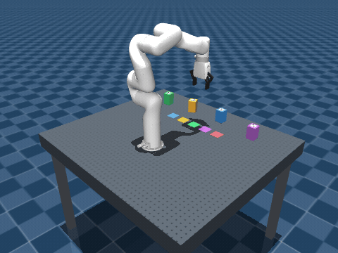

# Robot Arm Control — xArm7 optics simulation (MuJoCo / Isaac Sim)

Ubuntu 22.04 / Isaac Sim 5.1 的原始迁移背景、模块接口与交接步骤见 [交接文档](docs/isaac-sim-5.1-handoff.md)，本机最新验收结果见下文。

本机 Ubuntu / Isaac Sim 5.1 已完成 [Michelson 原生全流程验收](docs/isaac-michelson-validation-2026-11-03.md)：从空实验区物理装配五件器件、FAT 接触调镜、工具归还，以及归还后的新光学测量与独立审计。最终记录为 `runs/isaac-michelson-final-20261103-006`；当前 105 项测试通过。光学仍采用理想 LightPipes 模型和暂定机构参数。初始 ROS 2 图像与机械臂导入基线见 [Ubuntu 迁移记录](docs/ubuntu-isaac-migration-2026-11-03.md)。

在 Isaac 中可通过下面的三维 replay 查看完整轨迹并自由调整视角。仓库包含这次验收所需的轨迹、场景、相机采样、探测器图像和审计记录；大型中间光强数组和其他运行目录保留在生成它们的机器上，不纳入 Git。相机与光学监视器独立计时，手动启动时与三维 replay 不保证逐帧同步。[同步展示视频](docs/michelson-replay-presentation.md)可按需在本机导出，不随仓库分发。

```bash
cd ~/Desktop/workspace/robot-arm-control  # or your clone directory
# Run a new native experiment (output directory must be new); add --view for the Isaac window.
bash simulation/isaac/run_isaac_michelson.sh --output runs/isaac-new-run --stage full --view
# View the verified native trajectory without rerunning physics.
bash simulation/isaac/run_isaac_michelson_replay.sh --folder runs/isaac-michelson-final-20261103-006 --speed 4
# View archived control-camera captures and phase-scanned optical measurements.
./.venv/bin/python simulation/isaac/camera_optics_monitor.py --folder runs/isaac-michelson-final-20261103-006 --replay --speed 4
```

三维 replay 增加 Laser / Detector 近景按钮；旧记录也会在显示副本中补上激光器筒身、出光口和方形探测屏。它们是示意外观，保留原夹持支架与碰撞体；屏面不冒充实测条纹，真实光学结果仍在监视器中。

三维 replay 默认 4 倍速，完整实验约 60 秒。窗口提供 1 / 2 / 4 / 8 倍速、Pause / Resume、Restart 和前后 10 秒按钮；结束后保留场景，可继续切换相机、转动视角。倍速只改变回放时间，不改变控制参数；单独启动的光学监视器不会跟随三维窗口的暂停、跳转或倍速操作。

启动脚本默认从 `~/Documents/isaacsim/isaac-sim-standalone-5.1.0-linux-x86_64/python.sh` 查找 Isaac Sim。安装在其他位置时，先设置 `export ISAAC_SIM_PYTHON=/path/to/isaac-sim/python.sh`。这些回放读取已保存的验收记录，不重新运行物理控制或生成新的验收结果。

Backend implementations now live under `simulation/isaac/` and `simulation/mujoco/`; shared LightPipes optics and detector code remain in `simulation/`. The former top-level Python and shell entry points are compatibility launchers. The Isaac run reads the pinned MJCF as source geometry and kinematics but uses PhysX for motion, contacts, state, and camera rendering. For camera timestamps, recorded detector frames, and live viewing commands, see [Isaac camera and optics viewer](docs/isaac-camera-optics-view.md).

With `--view`, a separate renderer displays recent native PhysX states at a target 60 FPS. Both live and 3D replay offer Overview / Global / Wrist / FAT camera buttons. All preview cameras produce initial frames before arm motion starts. Opening `camera_optics_monitor.py --folder <active-run>` without `--replay` automatically enables continuous 480×270 global, wrist RGB-D and FAT-side previews, published at up to 15 Hz; the main view then targets a steady 30 FPS. Closing the monitor restores the single-view 60 FPS budget. The display uses 100 ms interpolation; physical simulation can progress slower than wall time. High-resolution control captures and optical acceptance retain the native worker's original pipeline. Live and replay share the [studio display profile](docs/isaac-camera-optics-view.md#2026-11-09-展示质感与播放控制): DLSS Quality, deterministic directional shadows, key/fill lighting, satin materials and smooth arm normals. The control-camera configuration is unchanged.

The MuJoCo [full Michelson process](docs/michelson-full-process.md) connects staged visual assembly, achieved-pose base holding, contact FAT adjustment, and LightPipes feedback in one persistent scene. Run `./.venv/bin/python -m simulation.michelson_experiment --output runs/michelson-live --view`. Native scene recordings can be watched with `./.venv/bin/python -m simulation.scene_recording --folder runs/michelson-full-demo --speed 3`; each sensor has its own window. The simpler preassembled benchmark remains available below.

The new [contact FAT / Michelson verification](docs/fat-contact-michelson.md) implements a dynamic, friction-gripped FAT, two motorized hex drivers, contact-driven knobs, and a two-axis mirror feeding a LightPipes interferometer. This is a separate preassembled-fixture benchmark; the original multi-object experiment's FAT stage still uses its geometric proxy. Run:

```bash
./.venv/bin/python -m simulation.fat_mechanics --michelson --output runs/michelson-demo --view
```

The verified run reaches 99.87% integrated phase-scan modulation visibility, retaining 99.83% after tool return. This metric is distinct from pinhole transmission. It uses ideal scalar optics, an ideal reference-phase scan, and provisional tool/mount mechanics; it does not assemble a Michelson interferometer from an empty table.

This repository is the robot-arm algorithm and control part of the optics robotics project. The current work runs without physical hardware. Team repository boundaries, ownership, and the contribution workflow are recorded in [docs/project-management.md](docs/project-management.md).

The [three-component layout adapter](docs/optical-layout-adaptation.md) adds posts and bases below the unchanged STL housings, raising the optical axes to 100 mm above the table. Run the simpler JSON-driven assembly → FAT visual alignment → return chain with:

```bash
./.venv/bin/python -m simulation.experiment --seed 7 \
  --layout configs/optical_setups/three_mounts.json --output runs/three-post-demo --view
```

The optional [LightPipes backend](docs/lightpipes-integration.md) now checks Gaussian propagation, thin lenses and pinhole transmission from design and saved actual poses. Add `--optics-spec configs/optical_setups/three_mounts_optics.json` to include it. Magnetic force and catastrophic-failure recovery remain unimplemented in that entry; contact screw-lever actuation is available in the separate Michelson benchmark above. Add `--adjust-optics` for bounded power-guided physical pinhole re-placement; see [position feedback](docs/optical-position-feedback.md). The five-component and single-object vision entries also use the supported geometry by default; older bare-frame checkpoints are incompatible.

With optical validation and `--view`, an additional independent [optical detector window](docs/optical-detector.md) displays the quantized intensity, power, centroid and measurement validity. It updates on newly computed observations and marks held frames explicitly; the optional power-guided adjustment loop publishes a new observation after each physical action.

The [2026-10-28 progress report](docs/progress-2026-10-28.md) covers FAT geometric alignment, dual 4K global vision, wrist RGB-D grasp refinement, and a native four-camera player. To watch the current single-object demonstration, install the requirements and run:

```bash
./.venv/bin/python -m simulation.vision_pick_place --seed 7 --output runs/wrist-live-demo --view
```

This opens the MuJoCo scene and separate native camera windows: global A, global B, wrist RGB, wrist depth, and FAT RGB. Sensor views are not combined or overlaid on the robot scene. Output directories are numbered automatically on repeated runs. Add `--camera-display browser` for optional per-camera browser pages or `--camera-fps 2` for lower preview load. These cameras are ideal simulation proxies; the wrist sensor is not yet a calibrated RealSense D435 model.

Camera windows now show [OpenCV detection overlays](docs/camera-detection-overlay.md): marker boxes, corners 0–3, IDs, diagnostic pose axes, reprojection errors and simulated calibration parameters. Detection runs at sensor resolution before preview scaling; the depth view reuses the aligned RGB corners. These annotations do not change control inputs or acceptance decisions.

The [integrated experiment entry point](docs/experiment-chain.md) now uses the selected original STL for all five housings (72 × 64 × 108 mm), with flat-face ArUco tags and physical recessed-side grasps. It places the objects in one persistent scene, picks up the FAT proxy, uses its own side-marker RGB observations to refine internal mount targets, and returns the tool:

```bash
./.venv/bin/python -m simulation.experiment --seed 7 --output runs/experiment-demo --view
```

The scene opens a fifth independent FAT RGB window. FAT pickup remains kinematic and the tips stop before the holes; physical insertion, screw turning and optical feedback are not simulated. All per-stage evidence and an assembly checkpoint are saved under the run directory.

Final STL placement now turns each housing 90° around world Z so its internal aperture axis follows the X row. Assembly checks both the measured aperture axes and an unobstructed geometric line through the row. Existing checkpoints from the unrotated layout must be reassembled; this geometry check does not simulate optical propagation.

This repository starts with the UFACTORY xArm7 model from [MuJoCo Menagerie](https://github.com/google-deepmind/mujoco_menagerie/tree/main/ufactory_xarm7). The model is a simplified MJCF description under BSD-3-Clause; the real laboratory gripper and calibrated robot parameters still need to be confirmed.

The separate [physical grasp validation](docs/housing-grasp.md) isolates the selected housing at a known pose. Its convex collision pieces preserve the windows and grip recesses; the same physical housing is now used by the vision/FAT experiment. See [STL integration](docs/stl-integration.md) for geometry calibration, verification evidence and remaining limitations. Historical non-vision scenes retain their cuboid proxies.

```bash
./.venv/bin/python -m simulation.housing_grasp --view
```

## macOS Apple Silicon setup

Use native arm64 Python 3.11. In this directory:

```bash
python3 -m venv .venv
source .venv/bin/activate
python -m pip install -r requirements.txt
```

The first model load downloads the pinned Menagerie release into its user cache. To check the model and control loop without opening a window:

```bash
./.venv/bin/python simulation/run_sim.py --headless
```

To watch the Home → joint 1 +20° → Home demonstration, run:

```bash
./.venv/bin/python simulation/run_sim.py
```

The arm returns Home after five seconds; close the viewer when finished. Other examples: `./.venv/bin/python simulation/run_sim.py --joint 2 --delta-deg 10` or `./.venv/bin/python simulation/run_sim.py --headless --joint 2 --delta-deg 10`. Calling `.venv/bin/python` directly also ensures the installed `mujoco_menagerie` package is used even if the shell has not activated the virtual environment.

The stock position actuators have a small steady error under gravity: holding the model's Home command produced up to about 0.0155 rad (0.89°) of arm-joint error in a headless check. The script reports the final error; its output should not be interpreted as precision placement performance.

The script uses MuJoCo's managed viewer, which runs with `python` on macOS. The passive viewer requires `mjpython`; its generated launcher fails when this project's virtual environment path contains spaces. The simulation uses the Menagerie `home` keyframe and sends smooth position targets to one joint while holding the other six at Home. The model includes a gripper actuator, but this demonstration does not move it.

## Five-component line assembly

Run the tabletop pick-and-place demonstration with a new scattered starting layout each time:

```bash
./.venv/bin/python simulation/line_assembly.py
```

For a reproducible run without a viewer:

```bash
./.venv/bin/python simulation/line_assembly.py --headless --seed 7
```

Watch the same layout, or use a fixed staging row for comparison:

```bash
./.venv/bin/python simulation/line_assembly.py --seed 7
./.venv/bin/python simulation/line_assembly.py --fixed
```

The default is an online Cartesian controller. It reads the current tool pose each physics step, uses the xArm7 Jacobian to calculate a damped joint velocity, and updates the seven joint position commands. The task phases are approach, grasp, lift, transfer, lower, release, and retreat. It does not solve a complete IK path in advance or replay a stored joint trajectory. After the fifth placement, the arm returns to a high park pose and maintains its commanded joint angles against gravity. The placement targets and initial object poses still come from simulator state.

You can run the same controller directly with `simulation/task_space_control.py`. To inspect the historical trajectory planner explicitly, use:

```bash
./.venv/bin/python simulation/line_assembly.py --seed 0 --legacy-planner bounded
```

To record a compact time-lapse GIF of a reproducible run, install `ffmpeg` (`brew install ffmpeg`) and run:

```bash
./.venv/bin/python simulation/line_assembly.py --seed 7 --record-gif docs/images/online-cartesian-pick-place.gif
```

The recording option runs the task headlessly, samples the MuJoCo scene, and writes the GIF at the path supplied. It needs an active macOS graphics session for MuJoCo's OpenGL renderer.



The seed makes one random scene repeatable. The arm base is on the table's horizontal centreline (`x=0`) and faces positive Y. All five starting cubes are scattered in front of it (`x=-0.35–0.35 m`, `y=0.08–0.56 m`); the target row is directly in front at `y=0.35 m`, with `x=-0.18, -0.09, 0, 0.09, 0.18 m`. Its centre is aligned with the arm base. Random starts keep at least 14 cm between cubes and 14 cm from target centres. A conservative radial range excludes the arm base and distant edges. Yaw is within ±30° by default; change it with `--yaw-range-deg` (0–45). The controller reads each cube's actual simulated starting pose and rotates it toward 0° yaw during transfer.

The arm is mounted on a dark optical breadboard with a 25 mm visual hole pattern and moves five 5 × 5 × 8 cm proxy housings to a straight target line in front of it: lens 1, pinhole, lens 2, beam splitter, and mirror. The holes are visual only; the collision surface remains flat. Each target is marked on the table. The tool rotates 90° about the vertical axis at grasp and placement so the fingers open perpendicular to the target row. Headless runs check both finger contacts, lift, sustained grip and table clearance during transfer, placement within 1 cm in XY and 5° in yaw and tilt, and unwanted arm/table or arm/other-object contacts. See [docs/paper-components.md](docs/paper-components.md) for how this scene maps to the paper, [docs/task-space-control.md](docs/task-space-control.md) for the new controller, and [docs/planner-comparison.md](docs/planner-comparison.md) for the historical planner experiments.

This is a handling demonstration, not a physically valid optical path. The source poses are simulator ground truth; the patterns on top of the cubes are **visual placeholders, not valid ArUco markers**. Object geometry, mass, friction, and goal coordinates are illustrative. The real gripper, holder dimensions, camera calibration, and collision constraints must be checked when hardware is chosen. The reported placement errors are simulation results and should not be interpreted as real-world accuracy or the paper's 0.5 mm correction threshold.

## FAT approach and alignment

After the five-object coarse assembly, run the scene with a flat fine-alignment-tool (FAT) proxy. Each mount has a marker and two adjustment targets on the same side:

```bash
./.venv/bin/python simulation/fat_alignment.py --seed 7
./.venv/bin/python simulation/fat_alignment.py --headless --seed 7
```

The FAT scene widens the target row to 18 cm center spacing, leaving 13 cm between adjacent 5 cm housings. Its slim 36 × 16 × 90 mm body is picked up directly from the table by clamping the left and right side faces above the two tool heads. The arm approaches each housing's marker and adjustment targets from its side, aligns both tool tips, retracts within the gap, then lifts clear before moving to the next housing. It returns the FAT to the table and parks above it. Targets are calculated from each side-marker pose and a fixed marker-to-screw transform. Headless validation checks gripper-to-FAT, FAT-to-table, and FAT-to-housing distances throughout the motion. This is a geometric control demonstration: the FAT is a non-contact visual proxy that follows the gripper after pickup; its camera is represented by a coordinate site, and no markers are decoded from images. The paper shows the FAT and mount schematically but does not give their dimensions; the illustrative sizes and validation limits are in [docs/fat-alignment.md](docs/fat-alignment.md).

## Current scope

[Placement error diagnostics](docs/placement-error-diagnostics.md) now separate TCP endpoint error, object motion relative to the gripper, and motion during/after opening. Each visual grasp run writes a signed vector budget and diagnostic trace without changing control commands.

The optional [settled placement strategy](docs/placement-settling-comparison.md), enabled with `--placement-strategy settled`, holds the attained TCP pose, requires sustained support contact and stationary motion, then opens the gripper over three seconds. The original `baseline` strategy remains the default for comparison.

Add `--precision` with the settled strategy for [sub-millimetre placement experiments](docs/precision-placement.md): critical TCP phases require 0.3 mm / 0.5° convergence and the posture helper uses a true nullspace projector in those phases. Final object XY error must also be at most 0.5 mm. Two ideal simulation layouts measured 0.267 mm and 0.249 mm; these are not hardware accuracy claims.

The standalone [two-camera 4K vision baseline](docs/global-camera.md) renders real ArUco patterns, detects them from 3840 × 2160 RGB images, and estimates tabletop object poses using a configured height/upright constraint. Run `./.venv/bin/python -m simulation.global_camera --seed 7 --output runs/global-camera-demo`. This scene uses a centered small side tag with both tuning targets below it.

The [single-object visual grasp demonstration](docs/vision-pick-place.md) passes those image-derived poses into the Cartesian controller: `./.venv/bin/python -m simulation.vision_pick_place --seed 7 --output runs/visual-grasp-demo`. It physically grasps and places one housing and checks contact, lift, transport and stable release. The default now includes [wrist RGB-D refinement](docs/wrist-rgbd.md) at pregrasp; use `--coarse-only` for the historical global-only baseline. Add `--record-gif` for an animation, `--hide-target-marker` to verify rejection before motion, or `--invalid-wrist-depth` to verify rejection before descent. Continuous visual servoing remains future work.

The single-joint demonstration is the M1 control baseline. The original line assembly adds Cartesian feedback control and object handling, and its FAT scene adds geometric tool approach and side-target alignment. Those original motion demonstrations do not consume image-based localization. The full Michelson entries documented above add image-derived assembly, contact screw actuation and simulated optical feedback. General obstacle avoidance, real camera calibration and real robot commands remain outside the verified scope. The Menagerie gripper should not be assumed to match the laboratory end effector.
