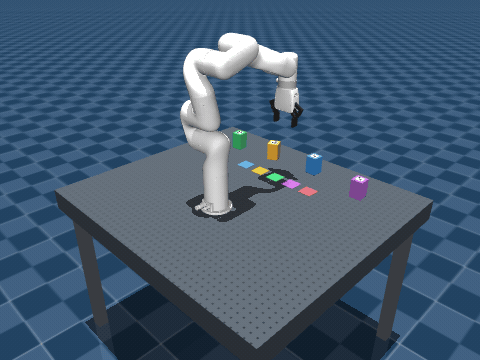

# Robot Arm Control — xArm7 MuJoCo simulation

This repository is the robot-arm algorithm and control part of the optics robotics project. The current work runs without physical hardware. Team repository boundaries, ownership, and the contribution workflow are recorded in [docs/project-management.md](docs/project-management.md).

The [2026-10-28 progress report](docs/progress-2026-10-28.md) covers FAT geometric alignment, dual 4K global vision, wrist RGB-D grasp refinement, and a native four-camera player. To watch the current single-object demonstration, install the requirements and run:

```bash
./.venv/bin/python -m simulation.vision_pick_place --seed 7 --output runs/wrist-live-demo --view
```

This opens the MuJoCo scene and **Robot Camera Player** with global A/B, wrist RGB and wrist depth. Output directories are numbered automatically on repeated runs. Add `--camera-display browser` for the optional browser dashboard or `--camera-fps 2` for lower preview load. These cameras are ideal simulation proxies; the wrist sensor is not yet a calibrated RealSense D435 model.

This repository starts with the UFACTORY xArm7 model from [MuJoCo Menagerie](https://github.com/google-deepmind/mujoco_menagerie/tree/main/ufactory_xarm7). The model is a simplified MJCF description under BSD-3-Clause; the real laboratory gripper and calibrated robot parameters still need to be confirmed.

## macOS Apple Silicon setup

Use native arm64 Python 3.11. In this directory:

```bash
python3 -m venv .venv
source .venv/bin/activate
python -m pip install -r requirements.txt
```

The first model load downloads the pinned Menagerie release into its user cache. To check the model and control loop without opening a window:

```bash
./.venv/bin/python simulation/run_sim.py --headless
```

To watch the Home → joint 1 +20° → Home demonstration, run:

```bash
./.venv/bin/python simulation/run_sim.py
```

The arm returns Home after five seconds; close the viewer when finished. Other examples: `./.venv/bin/python simulation/run_sim.py --joint 2 --delta-deg 10` or `./.venv/bin/python simulation/run_sim.py --headless --joint 2 --delta-deg 10`. Calling `.venv/bin/python` directly also ensures the installed `mujoco_menagerie` package is used even if the shell has not activated the virtual environment.

The stock position actuators have a small steady error under gravity: holding the model's Home command produced up to about 0.0155 rad (0.89°) of arm-joint error in a headless check. The script reports the final error; its output should not be interpreted as precision placement performance.

The script uses MuJoCo's managed viewer, which runs with `python` on macOS. The passive viewer requires `mjpython`; its generated launcher fails when this project's virtual environment path contains spaces. The simulation uses the Menagerie `home` keyframe and sends smooth position targets to one joint while holding the other six at Home. The model includes a gripper actuator, but this demonstration does not move it.

## Five-component line assembly

Run the tabletop pick-and-place demonstration with a new scattered starting layout each time:

```bash
./.venv/bin/python simulation/line_assembly.py
```

For a reproducible run without a viewer:

```bash
./.venv/bin/python simulation/line_assembly.py --headless --seed 7
```

Watch the same layout, or use a fixed staging row for comparison:

```bash
./.venv/bin/python simulation/line_assembly.py --seed 7
./.venv/bin/python simulation/line_assembly.py --fixed
```

The default is an online Cartesian controller. It reads the current tool pose each physics step, uses the xArm7 Jacobian to calculate a damped joint velocity, and updates the seven joint position commands. The task phases are approach, grasp, lift, transfer, lower, release, and retreat. It does not solve a complete IK path in advance or replay a stored joint trajectory. After the fifth placement, the arm returns to a high park pose and maintains its commanded joint angles against gravity. The placement targets and initial object poses still come from simulator state.

You can run the same controller directly with `simulation/task_space_control.py`. To inspect the historical trajectory planner explicitly, use:

```bash
./.venv/bin/python simulation/line_assembly.py --seed 0 --legacy-planner bounded
```

To record a compact time-lapse GIF of a reproducible run, install `ffmpeg` (`brew install ffmpeg`) and run:

```bash
./.venv/bin/python simulation/line_assembly.py --seed 7 --record-gif docs/images/online-cartesian-pick-place.gif
```

The recording option runs the task headlessly, samples the MuJoCo scene, and writes the GIF at the path supplied. It needs an active macOS graphics session for MuJoCo's OpenGL renderer.



The seed makes one random scene repeatable. The arm base is on the table's horizontal centreline (`x=0`) and faces positive Y. All five starting cubes are scattered in front of it (`x=-0.35–0.35 m`, `y=0.08–0.56 m`); the target row is directly in front at `y=0.35 m`, with `x=-0.18, -0.09, 0, 0.09, 0.18 m`. Its centre is aligned with the arm base. Random starts keep at least 14 cm between cubes and 14 cm from target centres. A conservative radial range excludes the arm base and distant edges. Yaw is within ±30° by default; change it with `--yaw-range-deg` (0–45). The controller reads each cube's actual simulated starting pose and rotates it toward 0° yaw during transfer.

The arm is mounted on a dark optical breadboard with a 25 mm visual hole pattern and moves five 5 × 5 × 8 cm proxy housings to a straight target line in front of it: lens 1, pinhole, lens 2, beam splitter, and mirror. The holes are visual only; the collision surface remains flat. Each target is marked on the table. The tool rotates 90° about the vertical axis at grasp and placement so the fingers open perpendicular to the target row. Headless runs check both finger contacts, lift, sustained grip and table clearance during transfer, placement within 1 cm in XY and 5° in yaw and tilt, and unwanted arm/table or arm/other-object contacts. See [docs/paper-components.md](docs/paper-components.md) for how this scene maps to the paper, [docs/task-space-control.md](docs/task-space-control.md) for the new controller, and [docs/planner-comparison.md](docs/planner-comparison.md) for the historical planner experiments.

This is a handling demonstration, not a physically valid optical path. The source poses are simulator ground truth; the patterns on top of the cubes are **visual placeholders, not valid ArUco markers**. Object geometry, mass, friction, and goal coordinates are illustrative. The real gripper, holder dimensions, camera calibration, and collision constraints must be checked when hardware is chosen. The reported placement errors are simulation results and should not be interpreted as real-world accuracy or the paper's 0.5 mm correction threshold.

## FAT approach and alignment

After the five-object coarse assembly, run the scene with a flat fine-alignment-tool (FAT) proxy. Each mount has a marker and two adjustment targets on the same side:

```bash
./.venv/bin/python simulation/fat_alignment.py --seed 7
./.venv/bin/python simulation/fat_alignment.py --headless --seed 7
```

The FAT scene widens the target row to 18 cm center spacing, leaving 13 cm between adjacent 5 cm housings. Its slim 36 × 16 × 90 mm body is picked up directly from the table by clamping the left and right side faces above the two tool heads. The arm approaches each housing's marker and adjustment targets from its side, aligns both tool tips, retracts within the gap, then lifts clear before moving to the next housing. It returns the FAT to the table and parks above it. Targets are calculated from each side-marker pose and a fixed marker-to-screw transform. Headless validation checks gripper-to-FAT, FAT-to-table, and FAT-to-housing distances throughout the motion. This is a geometric control demonstration: the FAT is a non-contact visual proxy that follows the gripper after pickup; its camera is represented by a coordinate site, and no markers are decoded from images. The paper shows the FAT and mount schematically but does not give their dimensions; the illustrative sizes and validation limits are in [docs/fat-alignment.md](docs/fat-alignment.md).

## Current scope

The standalone [two-camera 4K vision baseline](docs/global-camera.md) renders real ArUco patterns, detects them from 3840 × 2160 RGB images, and estimates tabletop object poses using a configured height/upright constraint. Run `./.venv/bin/python -m simulation.global_camera --seed 7 --output runs/global-camera-demo`. This scene uses a centered small side tag with both tuning targets below it.

The [single-object visual grasp demonstration](docs/vision-pick-place.md) passes those image-derived poses into the Cartesian controller: `./.venv/bin/python -m simulation.vision_pick_place --seed 7 --output runs/visual-grasp-demo`. It physically grasps and places one housing and checks contact, lift, transport and stable release. The default now includes [wrist RGB-D refinement](docs/wrist-rgbd.md) at pregrasp; use `--coarse-only` for the historical global-only baseline. Add `--record-gif` for an animation, `--hide-target-marker` to verify rejection before motion, or `--invalid-wrist-depth` to verify rejection before descent. Continuous visual servoing remains future work.

The single-joint demonstration is the M1 control baseline. The line assembly adds Cartesian feedback control and object handling, and the FAT scene adds tool approach and side-target alignment. Those motion demonstrations do not yet consume image-based localization. General obstacle avoidance, real camera calibration, screw actuation, optical feedback, and real robot commands remain outside the current scope. The Menagerie gripper should not be assumed to match the laboratory end effector.
